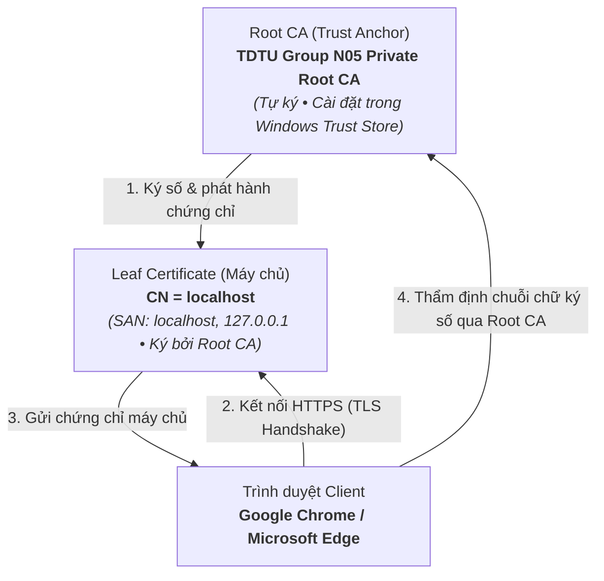

<div align="center">

# 🔐 PKI & Chain of Trust Demonstration

### **Học phần: Bảo mật thông tin — Nhóm N05**
**Trường Đại học Tôn Đức Thắng (TDTU)**

[](https://www.python.org/)
[](https://www.openssl.org/)
[]()
[]()
[]()

<p align="center">
  Dự án mô phỏng quy trình thiết lập kết nối an toàn <b>HTTPS</b> thông qua <b>Hạ tầng khóa công khai (PKI)</b>, xây dựng chuỗi chứng thực số (<b>Chain of Trust</b>), kiểm thử trạng thái <b>Untrusted vs Trusted</b> và thực nghiệm kịch bản tấn công <b>Rogue CA (MitM)</b>.
</p>

---

</div>

## 📌 Mục Lục

- [1. Giới thiệu & Mục tiêu đề tài](#1-giới-thiệu--mục-tiêu-đề-tài)
- [2. Kiến trúc & Chuỗi tin cậy (Chain of Trust)](#2-kiến-trúc--chuỗi-tin-cậy-chain-of-trust)
- [3. Cấu trúc thư mục dự án](#3-cấu-trúc-thư-mục-dự-án)
- [4. Yêu cầu môi trường & Cài đặt OpenSSL](#4-yêu-cầu-môi-trường--cài-đặt-openssl)
- [5. Hướng dẫn tạo Root CA và Chứng chỉ số (X.509)](#5-hướng-dẫn-tạo-root-ca-và-chứng-chỉ-số-x509)
- [6. Khởi động HTTPS Server & Kiểm thử nhanh](#6-khởi-động-https-server--kiểm-thử-nhanh)
- [7. Kịch bản Demo 1: Trạng thái Chưa tin cậy (Untrusted)](#7-kịch-bản-demo-1-trạng-thái-chưa-tin-cậy-untrusted)
- [8. Kịch bản Demo 2: Trạng thái Đã tin cậy (Trusted)](#8-kịch-bản-demo-2-trạng-thái-đã-tin-cậy-trusted)
- [9. Certificate Viewer & API trực quan](#9-certificate-viewer--api-trực-quan)
- [10. Module Mở Rộng: Kịch bản mô phỏng tấn công Rogue CA (Bonus)](#10-module-mở-rộng-kịch-bản-mô-phỏng-tấn-công-rogue-ca-bonus)
- [11. Xử lý các lỗi thường gặp (Troubleshooting)](#11-xử-lý-các-lỗi-thường-gặp-troubleshooting)
- [12. Dọn dẹp môi trường sau thực nghiệm](#12-dọn-dẹp-môi-trường-sau-thực-nghiệm)
- [13. Thành viên nhóm](#13-thành-viên-nhóm)

---

## 1. Giới thiệu & Mục tiêu đề tài

Dự án này được xây dựng nhằm minh họa thực tiễn nguyên lý hoạt động của **Public Key Infrastructure (PKI)** trong giao thức mạng an toàn:

* **Tự tạo Private Root CA:** Khởi tạo tổ chức cấp phát chứng chỉ gốc độc lập bằng thuật toán mã hóa bất đối xứng RSA 2048-bit và băm SHA-256.
* **Cấp phát chứng chỉ Server (Leaf Certificate):** Tạo CSR và phát hành chứng chỉ cho `localhost` kèm phần mở rộng tiêu chuẩn **Subject Alternative Name (SAN)**.
* **Triển khai HTTPS Server:** Xây dựng máy chủ HTTPS bằng Python với socket bảo mật TLS.
* **Kiểm chứng cơ chế Trust Store:** So sánh hành vi của trình duyệt khi Root CA chưa được cài đặt vào hệ thống và sau khi đã được tin cậy.
* **Phân tích dữ liệu mật mã:** Cung cấp RESTful API trích xuất và hiển thị trực quan cấu trúc chứng chỉ X.509 lên giao diện người dùng.

---

## 2. Kiến trúc & Chuỗi tin cậy (Chain of Trust)

Chuỗi tin cậy trong mô hình PKI được thiết lập theo cấp bậc từ **Root CA** xuống **Server Certificate**:



| Cấp bậc | Thực thể | Vai trò kỹ thuật trong hệ thống |
|:---|:---|:---|
| **Root CA (Gốc)** | `TDTU Group N05 Private Root CA` | Đóng vai trò là **Trust Anchor** (Điểm tựa tin cậy). Cần được cài vào kho *Trusted Root Certification Authorities* của hệ điều hành. |
| **Leaf Certificate (Ngọn)** | `localhost` | Chứng chỉ định danh cho HTTPS Server, chứa phần mở rộng **SAN** (`localhost`, `127.0.0.1`) do Root CA ký xác nhận. |
| **Relying Party (Xác thực)** | Trình duyệt Web (Chrome / Edge) | Tự động kiểm tra chữ ký số trên chứng chỉ máy chủ ngược về Root CA để cấp trạng thái **Ổ khóa xanh an toàn**. |

---

## 3. Cấu trúc thư mục dự án

```text
PKI-Demo-N05/
│
├── index.html                  # Giao diện chính: Dashboard & Certificate Viewer
├── server.py                   # HTTPS Web Server & Certificate API (/api/certificate)
├── localhost.ext               # Cấu hình X.509 Extensions (KeyUsage, SAN cho localhost)
├── README.md                   # Tài liệu hướng dẫn chi tiết
│
├── rootCA.key                  # Private Key của Root CA (Bảo mật tuyệt đối)
├── rootCA.crt                  # Chứng chỉ gốc (Trust Anchor cần cài vào Windows)
├── rootCA.srl                  # Quản lý số Serial phát hành chứng chỉ
│
├── localhost.key               # Private Key của HTTPS Server
├── localhost.csr               # Yêu cầu ký chứng chỉ (Certificate Signing Request)
├── localhost.crt               # Chứng chỉ số máy chủ (do Root CA ký)
│
└── attacker/                   # [Module mở rộng] Kịch bản mô phỏng tấn công MitM
    ├── evil_server.py          # Server giả mạo lắng nghe cổng 8443 để bắt tài khoản
    ├── fake_index.html         # Trang đăng nhập email mạo danh (giao diện xanh)
    ├── fake_localhost.ext      # Cấu hình SAN cho chứng chỉ giả
    ├── generate_fake_certs.bat # Script tự động sinh cert giả của hacker
    ├── evilCA.crt / key        # Root CA mạo danh (Rogue CA)
    └── fake_localhost.crt      # Chứng chỉ mạo danh do evilCA ký
```

> [!WARNING]
> Toàn bộ các file có định dạng `.key` là **Khóa riêng (Private Key)**. Trong môi trường thực tế, khóa riêng tuyệt đối không được phát tán hay commit lên kho mã nguồn công khai (đã được cấu hình chặn tự động trong `.gitignore`).

---

## 4. Yêu cầu môi trường & Cài đặt OpenSSL

### 1. Công cụ cần thiết
* **Python 3.10+**
* **OpenSSL** (hỗ trợ kiểm tra và ký chứng chỉ X.509)
* **Google Chrome** hoặc **Microsoft Edge**

---

### 2. Cài đặt OpenSSL trên Windows (Khi không dùng Git Bash)

Nếu bạn sử dụng **Windows CMD** hoặc **PowerShell** thuần (chưa cài đặt Git Bash), hãy chọn 1 trong các cách cài sau:

#### Cách A: Dùng Windows Package Manager (Khuyên dùng - Nhanh nhất)
Mở PowerShell hoặc CMD và chạy lệnh:
```powershell
winget install ShiningLight.OpenSSL
```
*(Hoặc cài Git for Windows để tích hợp sẵn cả Git Bash và OpenSSL: `winget install Git.Git`)*

#### Cách B: Tải bộ cài đặt trực tiếp
1. Truy cập trang phân phối chính thức: [slproweb.com - Win32/Win64 OpenSSL](https://slproweb.com/products/Win32OpenSSL.html).
2. Tải bản **Win64 OpenSSL Light** (bản cài đặt `.exe`).
3. Trong quá trình cài đặt, chọn tùy chọn sao chép file thực thi vào: **The OpenSSL binaries (/bin) directory**.
4. Thêm đường dẫn `C:\Program Files\OpenSSL-Win64\bin` vào biến môi trường `PATH`.

---

### 3. Kiểm tra môi trường & Cài đặt thư viện Python

Mở cửa sổ dòng lệnh và kiểm tra:
```bash
python --version
openssl version
```

Cài đặt thư viện `cryptography` để hỗ trợ giải mã chứng chỉ cho Certificate API:
```bash
python -m pip install cryptography
```

---

## 5. Hướng dẫn tạo Root CA và Chứng chỉ số (X.509)

Thực hiện tuần tự các bước sau trong thư mục dự án để tạo mới toàn bộ cặp khóa và chứng chỉ từ đầu:

### Bước 5.1: Tạo khóa riêng cho Root CA
Khởi tạo khóa bất đối xứng RSA 2048-bit:
```bash
openssl genrsa -out rootCA.key 2048
```

### Bước 5.2: Tạo chứng chỉ Root CA tự ký (Thời hạn 10 năm)
  ```cmd
  openssl req -x509 -new -nodes -key rootCA.key -sha256 -days 3650 -subj "/C=VN/ST=HoChiMinh/O=TDTU Group N05/CN=TDTU Group N05 Private Root CA" -out rootCA.crt
  ```

### Bước 5.3: Tạo khóa riêng cho HTTPS Server (localhost)
```bash
openssl genrsa -out localhost.key 2048
```

### Bước 5.4: Tạo Certificate Signing Request (CSR)
  ```cmd
  openssl req -new -key localhost.key -subj "/C=VN/ST=HoChiMinh/O=TDTU Group N05/CN=localhost" -out localhost.csr
  ```

### Bước 5.5: Tạo file cấu hình phần mở rộng X.509 (`localhost.ext`)
Đảm bảo file `localhost.ext` có đầy đủ các trường SAN để trình duyệt nhận diện:
```ini
authorityKeyIdentifier=keyid,issuer
basicConstraints=CA:FALSE
keyUsage = digitalSignature, nonRepudiation, keyEncipherment, dataEncipherment
extendedKeyUsage = serverAuth
subjectAltName = @alt_names

[alt_names]
DNS.1 = localhost
IP.1 = 127.0.0.1
```

### Bước 5.6: Dùng Root CA ký phát hành chứng chỉ `localhost.crt`
```bash
openssl x509 -req -in localhost.csr -CA rootCA.crt -CAkey rootCA.key -CAcreateserial -out localhost.crt -days 365 -sha256 -extfile localhost.ext
```

### Bước 5.7: Thẩm định chuỗi chứng chỉ (Verification)
```bash
openssl verify -CAfile rootCA.crt localhost.crt
```
*Kết quả hợp lệ:*
```text
localhost.crt: OK
```

---

## 6. Khởi động HTTPS Server & Kiểm thử nhanh

Sau khi đã có đủ các file chứng chỉ, khởi chạy máy chủ:

```bash
python server.py
```

*Màn hình hiển thị:*
```text
=============================================
PKI & CHAIN OF TRUST
HTTPS Server: https://localhost:8443
Certificate API: /api/certificate
Press Ctrl+C to stop
=============================================
```

Truy cập trên trình duyệt: **`https://localhost:8443`**

---

## 7. Kịch bản Demo 1: Trạng thái Chưa tin cậy (Untrusted)

| Mục tiêu | Minh chứng cơ chế phòng thủ của trình duyệt khi gặp Root CA lạ |
|---|---|
| **Điều kiện** | File `rootCA.crt` **CHƯA** được cài vào kho Trusted Root Store của Windows |
| **Thao tác** | Mở trình duyệt Chrome truy cập `https://localhost:8443` |
| **Hiện tượng** | Xuất hiện màn hình cảnh báo đỏ nguy hiểm: **"Your connection is not private"** |
| **Mã lỗi** | `NET::ERR_CERT_AUTHORITY_INVALID` |
| **Bản chất** | Trình duyệt kiểm tra chữ ký trên `localhost.crt`, thấy Issuer là `TDTU Group N05 Private Root CA` nhưng không tìm thấy CA này trong kho tin cậy của máy tính $\rightarrow$ Cảnh báo nguy cơ bị giả mạo / nghe lén |

---

## 8. Kịch bản Demo 2: Trạng thái Đã tin cậy (Trusted)

### Cách cài đặt Root CA vào Windows Trust Store:

#### Cách 1: Chạy lệnh nhanh (Yêu cầu quyền Administrator)
Mở Terminal/PowerShell với quyền **Administrator** tại thư mục dự án:
```powershell
certutil -addstore -f "Root" rootCA.crt
```

#### Cách 2: Thao tác bằng giao diện Windows
1. Nhấn phím `Win + R`, nhập `certmgr.msc` (Current User) hoặc `certlm.msc` (Local Machine) $\rightarrow$ Enter.
2. Tìm thư mục **Trusted Root Certification Authorities** (Chứng chỉ gốc tin cậy).
3. Nhấp đúp vào **Certificates** $\rightarrow$ Nhấp chuột phải chọn **All Tasks** $\rightarrow$ **Import...**
4. Chọn file [rootCA.crt](file:///f:/HK1-%2026-27/BMTT/final/PKI-Demo-N05/rootCA.crt) $\rightarrow$ Next $\rightarrow$ Finish.
5. Chọn **Yes** khi hộp thoại xác nhận bảo mật hiện ra.

### Kiểm tra kết quả:
1. **Khởi động lại Chrome triệt để:** Gõ `chrome://restart` trên thanh địa chỉ Chrome rồi nhấn Enter.
2. Truy cập lại: `https://localhost:8443`
3. **Hiện tượng:** Cảnh báo đỏ biến mất hoàn toàn, thay thế bằng **Biểu tượng Ổ khóa bảo mật** (Connection is secure).
4. Chuỗi xác thực (Certification Path) hoàn tất:
   ```text
   TDTU Group N05 Private Root CA  (Trust Anchor)
                 │
                 ▼
             localhost            (HTTPS Server Certificate)
   ```

---

## 9. Certificate Viewer & API trực quan

Giao diện [index.html](file:///f:/HK1-%2026-27/BMTT/final/PKI-Demo-N05/index.html) tích hợp sẵn tính năng phân tích chứng chỉ thông qua REST API:

### 1. Xem thông tin trực tiếp trên Web
Bấm nút **"View Certificate Details"** trên Dashboard để xem thông số kỹ thuật mật mã:
* **Subject:** `CN=localhost, O=TDTU Group N05, ST=HoChiMinh, C=VN`
* **Issuer:** `CN=TDTU Group N05 Private Root CA`
* **Serial Number:** Định danh duy nhất theo hệ thập lục phân.
* **Valid From / Valid Until:** Khoảng thời gian chứng chỉ có hiệu lực.
* **Signature Algorithm:** Thuật toán mã hóa chữ ký số (`sha256WithRSAEncryption`).
* **Subject Alternative Name (SAN):** `localhost`, `127.0.0.1`.
* **SHA-256 Fingerprint:** Mã băm chứng thực tính toàn vẹn.

### 2. Các Endpoint Backend API
* `GET /api/certificate`: Đọc trực tiếp [localhost.crt](file:///f:/HK1-%2026-27/BMTT/final/PKI-Demo-N05/localhost.crt), bóc tách cấu trúc ASN.1/X.509 và trả về JSON chuẩn.
* `GET /api/certificate/download`: Hỗ trợ tải file chứng chỉ công khai `localhost.crt`.

---

## 10. Module Mở Rộng: Kịch bản mô phỏng tấn công Rogue CA (Bonus)

> [!NOTE]
> Đây là module nâng cao chứng minh nguyên lý: **"Ổ khóa xanh không đồng nghĩa với an toàn tuyệt đối nếu máy tính bị thỏa hiệp kho Root Store!"**

Thư mục **`attacker/`** chứa một máy chủ giả mạo được thiết kế riêng:
* **Rogue CA:** Hacker tự tạo `evilCA.crt` với danh nghĩa *Evil Hacker Corp*.
* **Giả lập tấn công MitM:** 
  1. Giả lập máy nạn nhân bị cài lén `evilCA.crt` vào kho tin cậy qua lệnh:
     ```powershell
     certutil -user -addstore -f "Root" attacker\evilCA.crt
     ```
  2. Tắt server thật, chạy server của hacker:
     ```bash
     python attacker/evil_server.py
     ```
  3. Nạn nhân mở `https://localhost:8443` $\rightarrow$ Trình duyệt **vẫn báo Ổ khóa xanh** (do hệ thống đã tin `evilCA`).
  4. Nạn nhân an tâm nhập Email & Mật khẩu trên giao diện `fake_index.html` $\rightarrow$ Toàn bộ thông tin đăng nhập lập tức bị giải mã và in rõ trên terminal của kẻ tấn công!

---

## 11. Xử lý các lỗi thường gặp (Troubleshooting)

| Tình huống / Mã lỗi | Nguyên nhân | Hướng khắc phục |
|---|---|---|
| `ERR_CONNECTION_REFUSED` | Server Python chưa được bật | Chạy `python server.py` trong terminal. |
| `ModuleNotFoundError: cryptography` | Chưa cài thư viện mật mã | Chạy lệnh `python -m pip install cryptography`. |
| `Address already in use (Port 8443)` | Cổng 8443 đang bị chiếm dụng | Dừng server cũ bằng `Ctrl + C` trước khi khởi động lại. |
| **Đã cài `rootCA.crt` nhưng Chrome vẫn báo Not Secure** | Chrome còn tiến trình chạy ngầm lưu cache cũ | Gõ `chrome://restart` vào thanh URL của Chrome và bấm Enter. |
| `NET::ERR_CERT_COMMON_NAME_INVALID` | Chứng chỉ thiếu phần mở rộng SAN | Đảm bảo khi ký chứng chỉ đã sử dụng file `-extfile localhost.ext`. |

---

## 12. Dọn dẹp môi trường sau thực nghiệm

Sau khi hoàn tất buổi demo hoặc báo cáo, nên gỡ bỏ các Root CA thử nghiệm ra khỏi máy:
1. Nhấn `Win + R` $\rightarrow$ gõ `certmgr.msc` $\rightarrow$ Enter.
2. Vào **Trusted Root Certification Authorities** $\rightarrow$ **Certificates**.
3. Tìm chứng chỉ `TDTU Group N05 Private Root CA` (và `Evil Hacker Root CA` nếu có test kịch bản hacker).
4. Nhấp chuột phải chọn **Delete** và xác nhận.

---

## 13. Thành viên nhóm

<div align="center">

| STT | Họ và tên | MSSV | Vai trò & Phân công nhiệm vụ |
|:---:|:---|:---:|:---|
| **1** | **Nguyễn Thanh Tiền** | **524H0035** | Xây dựng PKI OpenSSL, cấu hình X.509 SAN & Triển khai HTTPS Server |
| **2** | **Nguyễn Minh Đăng** | **524H0082** | Thiết kế giao diện Dashboard, tích hợp Certificate REST API & Testing |
| **3** | **Trần Gia Huy** | **524H0092** | Kiểm chứng Chain of Trust, kịch bản Rogue CA & Hoàn thiện tài liệu |

<br/>

**BỘ MÔN AN TOÀN THÔNG TIN — ĐẠI HỌC TÔN ĐỨC THẮNG**  
*TP. Hồ Chí Minh — 2026*

</div>
